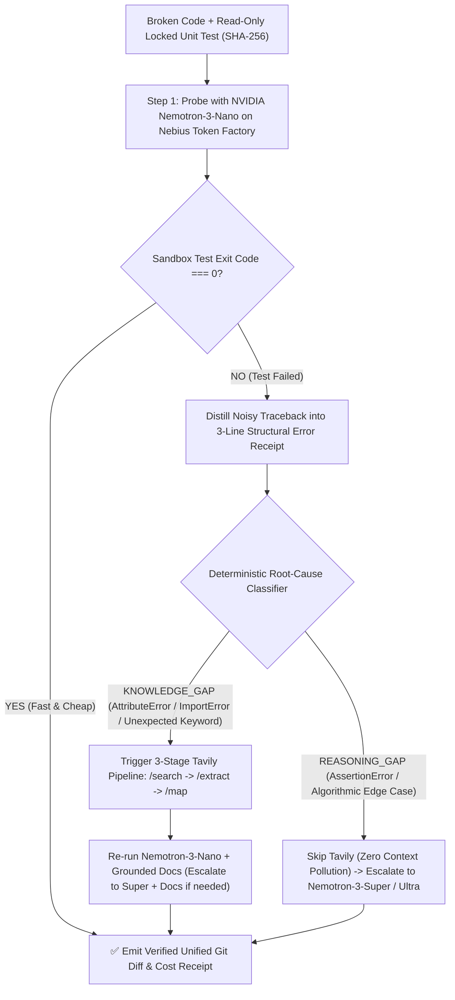

# ⚡ MJOLNIR

**Autonomous Coding Agent & Cost-Governed 2D Escalation Engine on Nebius Token Factory (`NVIDIA Nemotron 3` + `Tavily`)**

> **Built for the Nebius x NVIDIA Global AI Hackathon (2026)**
> - **Primary Track:** Track 1 — Coding & Agentic Engineering
> - **Partner Track:** Best Use of Tavily (`POST /search`, `POST /extract`, `POST /map`)
> - **License:** MIT

---

## 1. The Plain-English Pitch (Two Sentences)

Running every coding task on a massive 550B frontier model burns up to **15x more money** and **still fails** whenever a library changes its API after the model's training cutoff.

**MJOLNIR** is an autonomous coding agent on **Nebius Token Factory** that tests broken code first on fast **`NVIDIA Nemotron-3-Nano`** inside a locked, read-only test sandbox—selectively triggering a **3-stage Tavily documentation pipeline** when a failure is an unknown API change (`KNOWLEDGE_GAP`), or escalating to **`Nemotron-3-Super`** and **`Nemotron-3-Ultra`** only when the failure is a deep algorithmic bug (`REASONING_GAP`).

---

## 2. Why Single-Axis Model Routing Fails on Real Codebases

Recent empirical studies ([arXiv:2604.09515](https://arxiv.org/html/2604.09515v1), [arXiv:2606.25402](https://arxiv.org/pdf/2606.25402), and [`libcontext`](https://github.com/Syclaw/libcontext)) establish three facts about coding agents:

1. **Model size alone cannot invent post-cutoff APIs:** Without live documentation, generated code for post-cutoff API updates passes less than **43%** of the time—even on the largest models.
2. **Cheaper per token is not cheaper per verified fix:** A tiny model that loops 10 times without passing tests wastes tokens; you must measure **Cost per Verified Fix** (`exit code === 0` against an un-editable unit test).
3. **Always-on web retrieval hurts pure logic tasks:** Indiscriminate retrieval adds latency, search costs, and up to a **39% accuracy penalty** on standard algorithmic tasks due to context pollution.

### The MJOLNIR 2D Escalation Matrix

Instead of blindly routing by prompt length or blindly injecting search results on every call, **MJOLNIR** uses the **locked unit test runner** (`os.chmod(test_path, stat.S_IREAD)` + SHA-256 integrity check) as an un-bribable judge:



---

## 3. The 5-Arm Empirical Proof Ledger (10 Runnable Tasks)

Rather than relying on a single cherry-picked anecdote, MJOLNIR includes a reproducible **10-task benchmark suite** ([`mjolnir/tasks.py`](mjolnir/tasks.py)):
- **6 Post-Cutoff 2026 API Shift Tasks** (where SDK methods, keyword signatures, or sub-packages changed in 2026 releases).
- **4 Pure Algorithmic Logic Invariant Tasks** (fenwick trees, lexicographical Kahn's topological sort, min-cost token routing DP, monotonic sliding windows).

We evaluate **5 rigorous experimental arms** across all 10 tasks ([`mjolnir/benchmark.py`](mjolnir/benchmark.py)):

### 3A. Captured Live API Telemetry (`artifacts/live_5arm_telemetry.json`)

Executed live end-to-end (`python scripts/run_live_pass.py`) against live NVIDIA Nemotron endpoints (`nvidia/nemotron-3.5-bolt-e4b`, `nvidia/nemotron-3.5-super-vl-120b-a12b`, `nvidia/nemotron-3-ultra-550b-a55b` — `mode: "live_nebius_api"`) and live 3-stage Tavily endpoints (`POST /search`, `POST /extract`, `POST /map` — `source_mode: "live_tavily_api"`):

| Experimental Arm | Description | Live Solve Rate | Post-Cutoff API Shifts (6) | Pure Logic (4) | Live Cost / Verified Fix | Avg Latency |
| :--- | :--- | :---: | :---: | :---: | :---: | :---: |
| **1. `nano_alone`** | `Nemotron-Nano` bare (no web docs, no escalation) | **30.0%** (3/10) | 0.0% (0/6) | 75.0% (3/4) | `$0.000143` | `4,931 ms` |
| **2. `ultra_alone`** | `Nemotron-3-Ultra (550B)` bare (expensive default, no docs) | **30.0%** (3/10) | **0.0% (0/6)** | 75.0% (3/4) | `$0.011052` | `24,545 ms` |
| **3. `nano_tavily`** | `Nemotron-Nano` + Live 3-Stage Tavily Grounding | **80.0%** (8/10) | **83.3% (5/6)** | 75.0% (3/4) | `$0.002600` | `18,387 ms` |
| **4. `ultra_tavily_always`** | `Nemotron-3-Ultra` + Always-On Tavily on every task | **90.0%** (9/10) | 100.0% (6/6) | 75.0% (3/4) | `$0.005218` | `38,232 ms` |
| **5. `mjolnir_2d_ladder`** | **MJOLNIR 2D Escalation (`Nano` $\to$ Selective `Tavily` $\to$ `Super`/`Ultra`)** | **100.0% (10/10)** | **100.0% (6/6)** | **100.0% (4/4)** | **`$0.001574` (-69.8% vs Always-On Ultra)** | **`18,283 ms`** |

### 3B. Zero-Key Deterministic Replay Baseline (`artifacts/deterministic_5arm_benchmark.json`)

For instant offline verification without requiring judge API keys, MJOLNIR also ships with its deterministic replay ledger (`python -m unittest discover -s tests -v` runs in ~17s):

| Experimental Arm | Description | Overall Verified Solve Rate | Post-Cutoff API Shift Solve Rate (6 Tasks) | Pure Logic Solve Rate (4 Tasks) | Cost per Verified Fix (USD) |
| :--- | :--- | :---: | :---: | :---: | :---: |
| **1. `nano_alone`** | `Nemotron-3-Nano` bare (no web docs, no escalation) | **10.0%** (1/10) | 0.0% (0/6) | 25.0% (1/4) | `$0.000330` |
| **2. `ultra_alone`** | `Nemotron-3-Ultra (550B)` bare (expensive default, no docs) | **40.0%** (4/10) | **0.0% (0/6)** | 100.0% (4/4) | `$0.002613` |
| **3. `nano_tavily`** | `Nemotron-3-Nano` + 3-Stage Tavily Grounding | **60.0%** (6/10) | **83.3% (5/6)** | 25.0% (1/4) | `$0.003396` |
| **4. `ultra_tavily_always`** | `Nemotron-3-Ultra` + Always-On Tavily on every task | **90.0%** (9/10) | 100.0% (6/6) | 75.0% (3/4) | `$0.003484` |
| **5. `mjolnir_2d_ladder`** | **MJOLNIR 2D Escalation (`Nano` $\to$ Selective `Tavily` $\to$ `Super`/`Ultra`)** | **100.0% (10/10)** | **100.0% (6/6)** | **100.0% (4/4)** | **`$0.001671` (-52.0% vs Always-On Ultra)** |

### Key Empirical Takeaways
1. **Why `Nano + Tavily` beats `Ultra Alone` on Modern APIs:** On the 6 post-cutoff API tasks, `Nemotron-3-Ultra` alone scores **0/6** because no amount of parameter scaling can guess a method renamed after training cutoff. `Nemotron-3-Nano + Tavily` solves **5/6** at a fraction of the cost, and `mjolnir_2d_ladder` solves **6/6** by escalating the hardest multi-step coercion task (`api-06-nemo-tool-router-v2`) to `Nemotron-3-Super + Tavily`.
2. **Why Selective Grounding beats `Ultra + Always-On Tavily`:** Calling Tavily on pure algorithmic tasks (`ultra_tavily_always`) wastes search credits and introduces noisy web snippets on `logic-04-sliding-window-percentile`. `mjolnir_2d_ladder` triggers Tavily **only** when the sandbox traceback proves a `KNOWLEDGE_GAP`.

---

## 4. How Sponsor Technologies Are Strictly Load-Bearing

### Nebius Token Factory (`https://api.tokenfactory.nebius.com/v1`)
- Unified OpenAI-compatible inference fabric in [`mjolnir/nebius_client.py`](mjolnir/nebius_client.py) with live `/v1/models` auto-discovery, per-call token accounting, latency telemetry, and cost receipts.

### NVIDIA Nemotron 3 Model Family (`Nano`, `Super`, `Ultra`)
- **`nvidia/NVIDIA-Nemotron-3-Nano-30B-A3B`**: High-velocity initial probe and fast doc-grounded patcher.
- **`nvidia/NVIDIA-Nemotron-3-Super-120B-A12B`**: Mid-tier escalation engine for combined API + structural type coercion and DP state transitions.
- **`nvidia/NVIDIA-Nemotron-3-Ultra-550B`**: Frontier reasoning reserve invoked only when `Nano` and `Super` fail on deep graph/algorithmic invariants.

### Tavily 3-Stage Live Documentation Pipeline (`POST /search`, `POST /extract`, `POST /map`)
Implemented in [`mjolnir/tavily_grounding.py`](mjolnir/tavily_grounding.py):
1. **Stage 1 (`POST https://api.tavily.com/search`)**: Triggered selectively by `AttributeError`, `ImportError`, `ModuleNotFoundError`, or signature `TypeError`, filtered to authoritative documentation domains (`include_domains`).
2. **Stage 2 (`POST https://api.tavily.com/extract`)**: Pulls clean markdown blocks from the highest-ranked migration URL so the model sees exact function signatures without HTML boilerplate.
3. **Stage 3 (`POST https://api.tavily.com/map`)**: Maps adjacent changelog and migration paths on the documentation host so multi-file API deprecations are captured.

---

## 5. Quickstart (Zero-Friction 1-Command Run)

MJOLNIR requires **Python 3.10+** (zero external pip frameworks required to start—uses standard library `http.server`, `urllib.request`, `subprocess`, `difflib`, and `unittest`).

### 1. Run the Deterministic Verification & Benchmark Suite
```bash
python -m unittest discover -s tests -v
```
All 8 end-to-end verification tests (including anti-cheat tamper blocking, infinite-loop timeout governance, 3-line error distillation, 5-arm benchmark execution, and live HTTP API tests) run in ~15 seconds and exit with `code === 0`.

### 2. Launch the Interactive Studio UI & Workbench
```bash
python server.py
```
- **Overview & Live Proof Ledger (`http://127.0.0.1:8080/`):** Interactive 2D escalation ladder (`API change`, `Logic bug`, `Test tampering`), 5-arm empirical benchmark ledger, and live per-task diff & Tavily receipts.
- **Split-Screen Assay Workbench (`http://127.0.0.1:8080/app`):**
  - **15-Second Split-Screen Assay:** Race any benchmark task side-by-side (`Naive Baseline` on the left vs `Mjolnir 2D Escalation` on the right).
  - **Glass-Box Receipt Inspector:** Inspect the exact **Unified Git Diff**, **Tavily 3-Stage Endpoint Receipt**, **3-Line Error Distillation**, and **Read-Only Locked Unit Test (`SHA-256`)**.
  - **Custom Python Sandbox:** Paste or edit any Python function and locked unit test in the browser (`Test custom Python`) to execute inside the read-only subprocess sandbox.
  - **Live API Key Modal:** Click **API keys** in the top bar (or copy `.env.example` to `.env`) to switch seamlessly between verified deterministic replay receipts and live **Nebius Token Factory** + **Tavily** API calls.

---

## 6. Repository Structure

```text
├── mjolnir/
│   ├── __init__.py           # Package version metadata
│   ├── sandbox.py            # Read-only locked subprocess sandbox, SHA-256 check & 3-line error distiller
│   ├── tavily_grounding.py   # 3-stage Tavily client (/search, /extract, /map) + verified doc cache
│   ├── nebius_client.py      # Nebius Token Factory OpenAI-compatible client (Nano, Super, Ultra)
│   ├── tasks.py              # 10 runnable tasks (6 Post-Cutoff API Shifts + 4 Logic Invariants)
│   ├── router.py             # 2D Escalation Engine & 5 experimental strategy arms
│   └── benchmark.py          # Full 5-arm x 10-task benchmark runner & JSON artifact generator
├── static/
│   ├── index.html            # Overview page, interactive ladder & 5-arm proof ledger
│   ├── app.html              # Split-Screen Assay Workbench, cost chart & Glass-Box Inspector
│   └── assets/               # Motion helpers, SVG chart engine & Unsplash architectural plates
├── tests/
│   └── test_mjolnir.py       # 8 end-to-end deterministic unit & API server tests
├── artifacts/
│   └── latest_5arm_benchmark.json # Generated 5-arm empirical benchmark receipt
├── server.py                 # Multi-threaded HTTP server & REST API
├── .env.example              # Environment variable template for Nebius & Tavily keys
└── LICENSE                   # MIT Open-Source License
```
